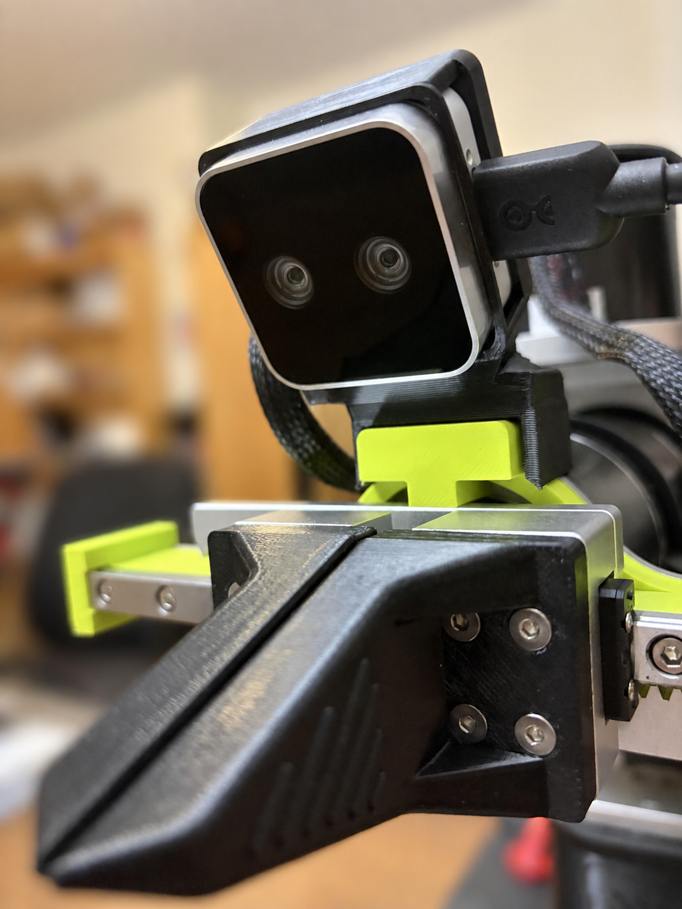
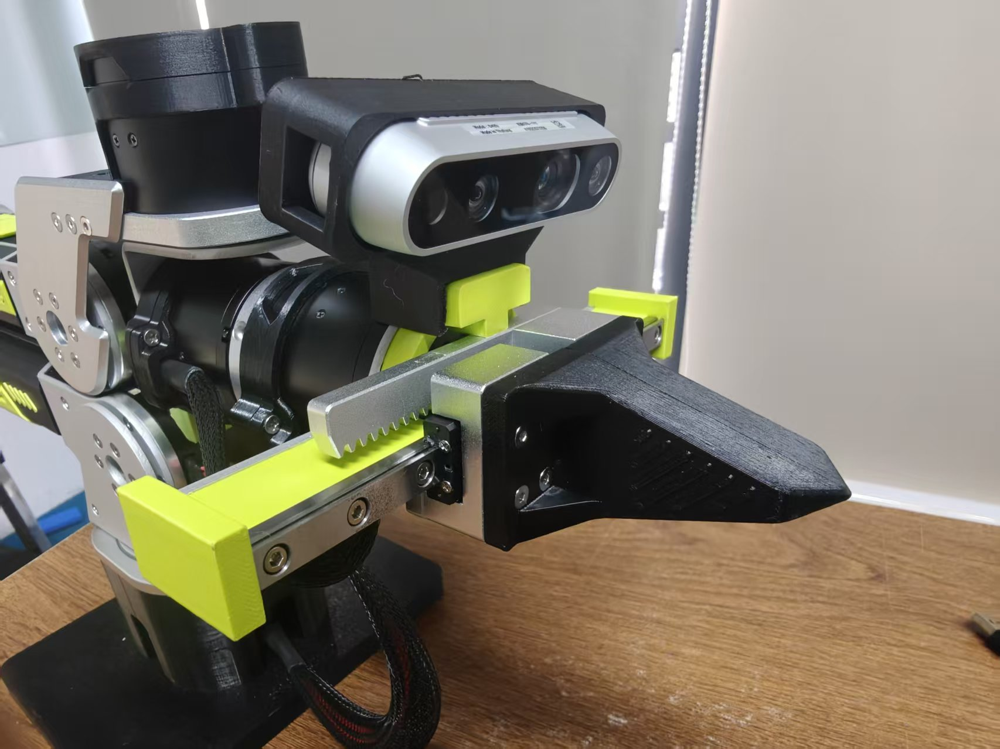
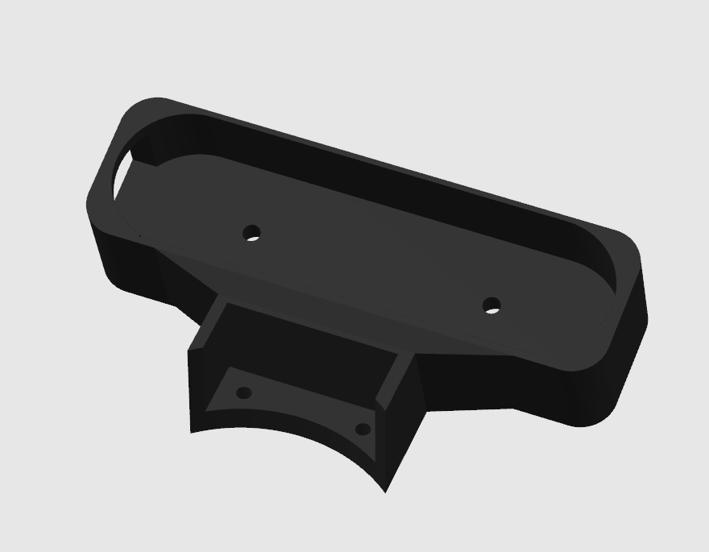
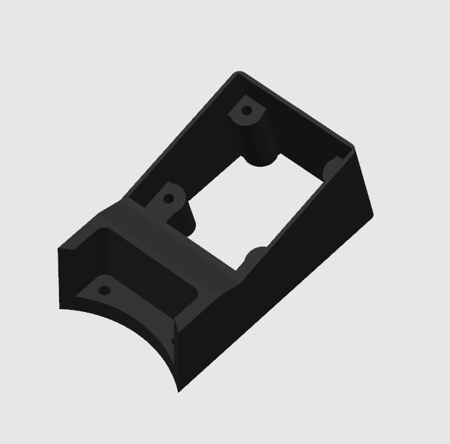

# B601 Camera Mounts — V1

English | [简体中文](README_zh.md)

Historical wrist camera mounts from before the September 18, 2026 update.

> **For better data collection results, use the [latest B601 wrist mounts](../../README.md#b601-camera-mounts).** For data collection support frames, use the [V2 assembly](../../README.md#v2-aluminum-extrusion-camera-mount). V1 is retained for reference by existing projects.

## STEP models

| Mount | Download |
| --- | --- |
| D405 / Gemini 305 | [D405_305_Mount.step](D405_305_Mount.step) |
| D435 / Gemini 2 | [D435_Gemini2_Mount.step](D435_Gemini2_Mount.step) |
| UVC32 | [UVC32_mount.step](UVC32_mount.step) |

D435 and Gemini 2 share one STEP model, giving three models for the four reference images below.

## Historical reference images

These images are copied from the same historical repository revision. They are reference illustrations; they are not newly generated previews of the archived STEP models or evidence of verified fit.

### D405 / Gemini 305

### D435i

### Gemini 2

### UVC

## Source and license

Copied without changing file contents from [the original B601-DM parts directory](https://github.com/Seeed-Projects/reBot-DevArm/tree/239af75936547ce5bdc44430d100a4eb78845413/hardware/reBot_B601_DM/3D_Printed_Parts/) at commit `239af75936547ce5bdc44430d100a4eb78845413`. This archive is labeled V1 here. The models and reference images retain the repository’s CERN OHL-W-2.0 license; see [NOTICE.md](../../NOTICE.md) and [LICENSE](../../LICENSE).
