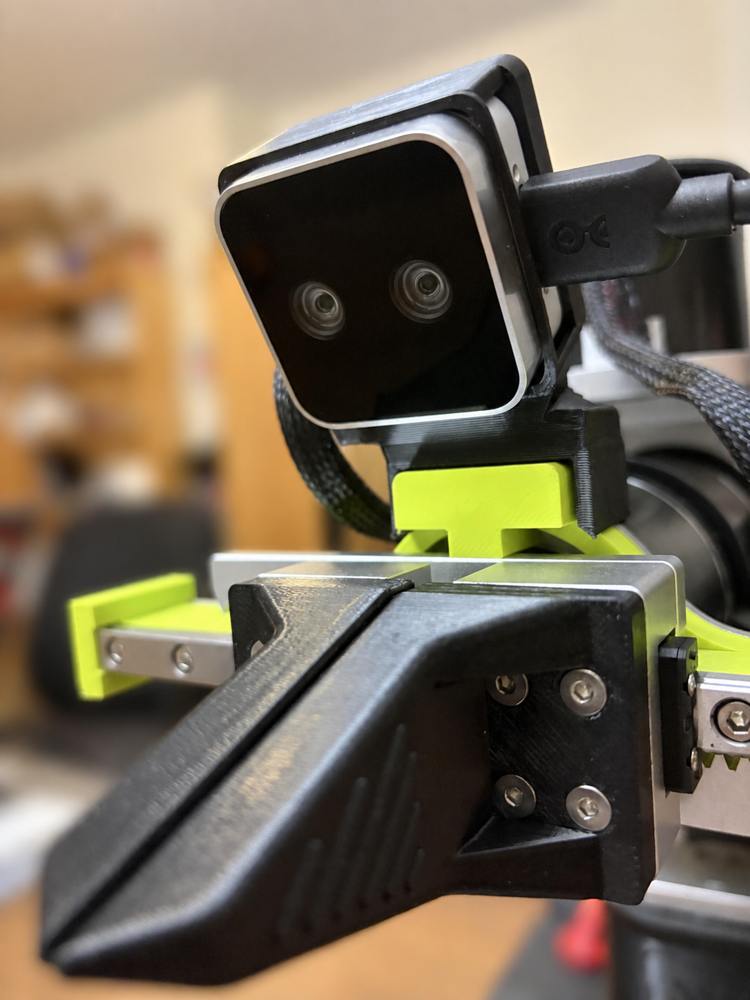
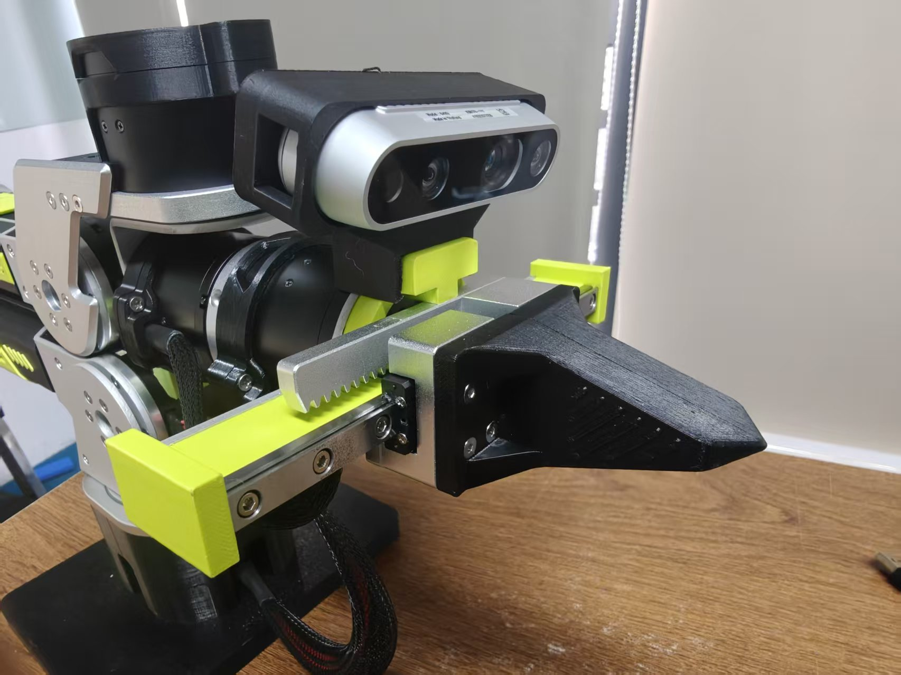
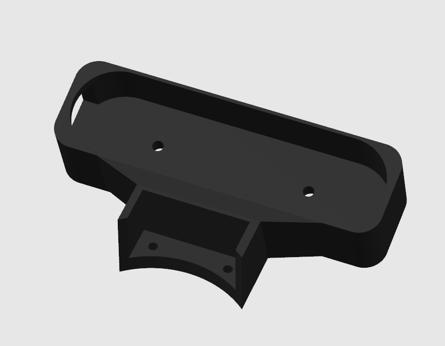
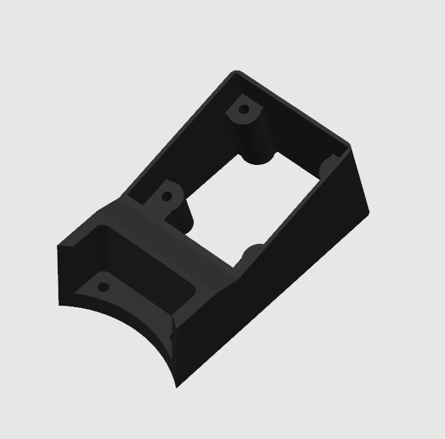

# B601 摄像头支架 — V1

[English](README.md) | 简体中文

此目录归档 2026 年 9 月 18 日更新前的腕部相机支架。

> **为获得更好的数据采集效果，建议优先选用[最新 B601 腕部相机支架](../../README_zh.md#b601-摄像头支架)。**数据采集支撑架建议选用 [V2 铝型材装配](../../README_zh.md#v2铝型材摄像头支架)。V1 保留供已有项目参考。

## STEP 模型

| 支架 | 下载 |
| --- | --- |
| D405 / Gemini 305 | [D405_305_Mount.step](D405_305_Mount.step) |
| D435 / Gemini 2 | [D435_Gemini2_Mount.step](D435_Gemini2_Mount.step) |
| UVC32 | [UVC32_mount.step](UVC32_mount.step) |

D435 和 Gemini 2 共用一个 STEP 模型，因此下方 4 张参考图对应 3 个模型文件。

## 历史参考图

这些图片与模型均取自同一个历史提交，用于参考外观；图片并非对归档 STEP 重新生成的预览，也不代表已完成适配验证。

### D405 / Gemini 305

### D435i

### Gemini 2

### UVC

## 来源与许可

文件原样取自[原 B601-DM 零件目录](https://github.com/Seeed-Projects/reBot-DevArm/tree/239af75936547ce5bdc44430d100a4eb78845413/hardware/reBot_B601_DM/3D_Printed_Parts/)，来源提交为 `239af75936547ce5bdc44430d100a4eb78845413`，在此归档并标记为 V1。模型和参考图沿用仓库的 CERN OHL-W-2.0 许可，详见 [NOTICE.md](../../NOTICE.md) 和 [LICENSE](../../LICENSE)。
